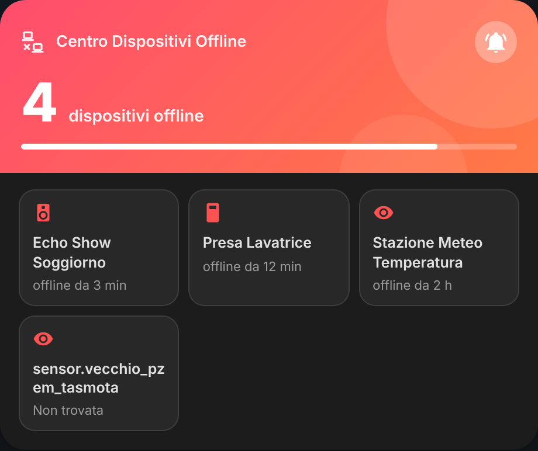
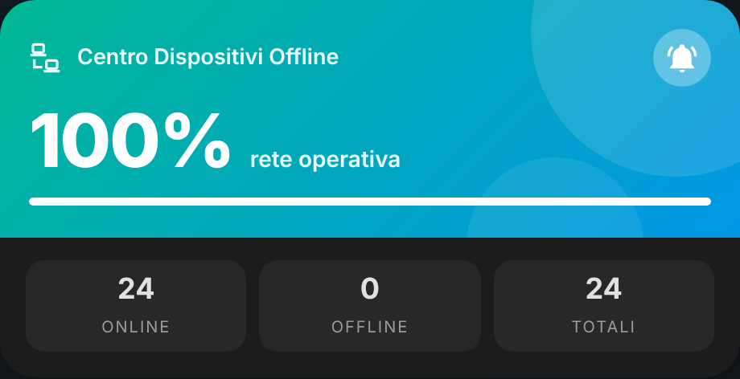
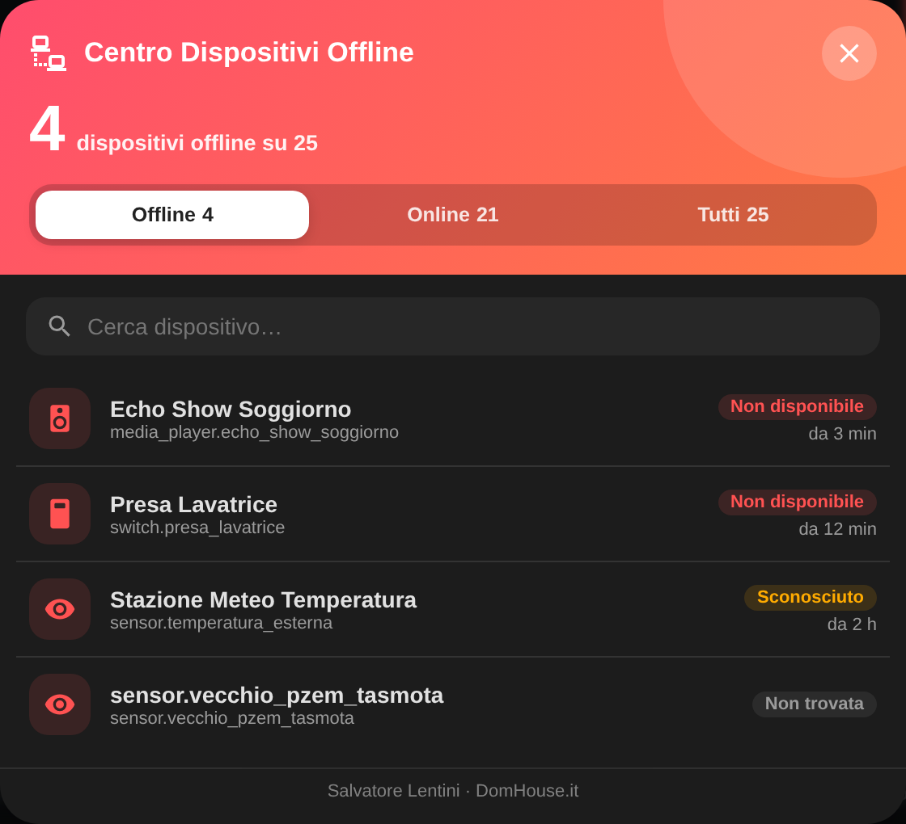

# 📡 DomHouse - Centro Dispositivi Offline (Card)

[](hCentro-Dispositivi-Offline-Card/blob/main/README_it.md)
[](https://github.com/SalvatoreITA/Centro-Dispositivi-Offline-Card/blob/main/README.md)

[](https://github.com/hacs/integration)
[]()
[](https://www.domhouse.it)

**Centro Dispositivi Offline Card** è la card Lovelace pensata per il backend [Centro Dispositivi Offline](https://github.com/SalvatoreITA/Centro-Dispositivi-Offline): ti mostra a colpo d'occhio quali dispositivi sono offline, da quanto tempo e perché.

## 📸 Anteprima

<div align="center">
  
  
  <br><br>
  
</div>

## ✨ Funzionalità

* **Stile Hero:** intestazione colorata (rosso/arancio in allarme, verde/azzurro quando è tutto ok) con il numero grande dei dispositivi offline e la barra di stato della rete.
* **Riquadri dei dispositivi offline:** icona del tipo di entità, nome e da quanto tempo è offline (o se è stata eliminata/disabilitata).
* **Popup integrato, senza browser_mod:** schede Offline / Online / Tutti, ricerca, motivo dello stato (`Non disponibile`, `Sconosciuto`, `Non trovata`, `Disabilitata`) e tempo. Toccando un dispositivo si apre la sua finestra *more-info* di Home Assistant. Su smartphone si apre dal basso a tutto schermo.
* **Campanella:** attiva/disattiva l'automazione delle notifiche, come nella v2 (si sceglie nell'editor).
* **Altri stili:** oltre a *Hero* sono disponibili *Anello* (grafico circolare) e *Compatta* (una riga).
* **Editor grafico** completo, tema chiaro e scuro, compatibile con le dashboard a sezioni.

## ⚠️ Prerequisiti

* **[Centro Dispositivi Offline](https://github.com/SalvatoreITA/Centro-Dispositivi-Offline)**

## 📦 Installazione

### Tramite HACS (consigliato)
1. Apri **HACS** > tre puntini in alto a destra > **Repository personalizzati**.
2. Incolla `https://github.com/SalvatoreITA/Centro-Dispositivi-Offline-Card` e scegli la categoria **Dashboard**.
3. Cerca **Centro Dispositivi Offline Card**, clicca su **Scarica** e ricarica il browser.

### Manuale
1. Copia `centro-offline-card.js` nella cartella `www/` di Home Assistant.
2. **Impostazioni** > **Dashboard** > **Risorse** > aggiungi `/local/centro-offline-card.js` come **Modulo JavaScript**.
3. Ricarica il browser.

## ⚙️ Configurazione

Aggiungi la card dalla dashboard cercando **DomHouse - Centro Dispositivi Offline Card**: con l'integrazione installata funziona subito senza toccare nulla.

Esempio YAML con tutte le opzioni:

```yaml
type: custom:centro-offline-card
title: Centro Dispositivi Offline
layout: hero            # hero | ring | compact
border_radius: 16
show_progress: true     # barra di stato nell'intestazione
max_chips: 6            # riquadri offline mostrati nella card (0 = nessuno)
automation_entity: automation.notifiche_dispositivi_offline   # automazione comandata dalla campanella
entity: sensor.dispositivi_offline
online_entity: sensor.dispositivi_online
total_entity: sensor.dispositivi_totali
```

## ☕ Supporta il Progetto

Ogni piccolo supporto fa un'enorme differenza: mi aiuta a mantenere vivo l'entusiasmo e mi stimola a creare e condividere nuove soluzioni per la community. Grazie di cuore per il tuo aiuto! 🚀

[](https://ko-fi.com/salvatore_dh)

## ❤️ Crediti
Sviluppato da [Salvatore Lentini - DomHouse.it](https://www.domhouse.it)
